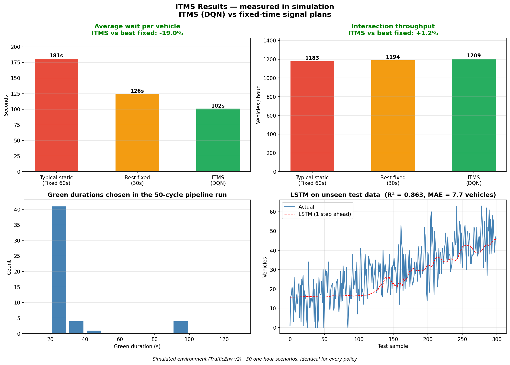

# ITMS Karachi — Intelligent Traffic Management System

AI pipeline for adaptive traffic-signal control: **YOLOv8** vehicle detection → **LSTM** traffic forecasting → **Double-DQN** signal timing, with emergency/accident overrides. Iqra University · BS Computer Science · AI Project.

**Live demo (3D traffic simulation):** enable GitHub Pages on the `docs/` folder (Settings → Pages → Branch: main, folder: /docs), then open your Pages link.

## Results (measured in simulation)
All policies were evaluated on the same 30 random one-hour scenarios (never used in training).

| Metric | Best fixed plan (Fixed 30s) | Fixed 60 s | **ITMS (DQN)** |
|---|---|---|---|
| Avg wait per vehicle | 125.5 s | 181.4 s | **101.7 s** (-19% / -44%) |
| Throughput (veh/h) | 1194 | 1183 | **1209** (+1.2% vs best fixed) |

LSTM forecast (test set): R² **0.8631**, MAE **7.66 vehicles**, RMSE **9.673 vehicles**.

## Repository layout
- `notebooks/ITMS_Karachi_Kaggle_v2.ipynb` — full pipeline (data → LSTM → DQN → evaluation → dashboard). Resumable, with smoke tests.
- `docs/index.html` — interactive 3D/2D traffic simulation page.
- `models/` — trained LSTM and DQN, scaler, metrics. `results/` — charts and evaluation tables.
- `data/` is not stored: the notebook regenerates it (seeded, identical each run).

## Run it
1. Upload the notebook to Kaggle, then **Save & Run All (Commit)** (GPU optional; Internet only for the YOLO demo). It takes a few minutes.
2. Or locally: `pip install -r requirements.txt`, then run the notebook.

## Limitations
- Simulated environment and synthetic data, not live Karachi sensors.
- A hand-written rule-based reference still beats the learned DQN; ITMS is shown to beat fixed-time signals, not to be optimal.
- The YOLO demo uses a synthetic image; real counts need real road footage.
- The web demo controller is a queue-responsive rule that mimics the learned policy; the DQN results above come from the Python simulator.
