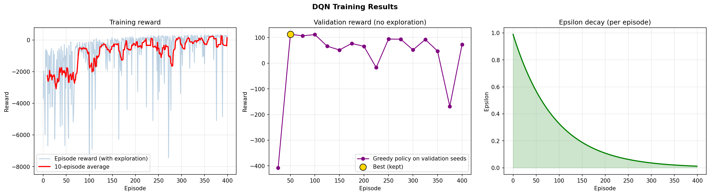
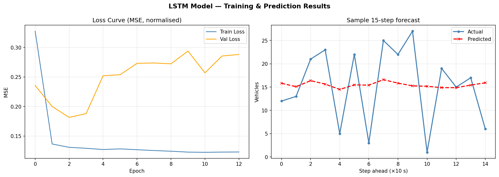
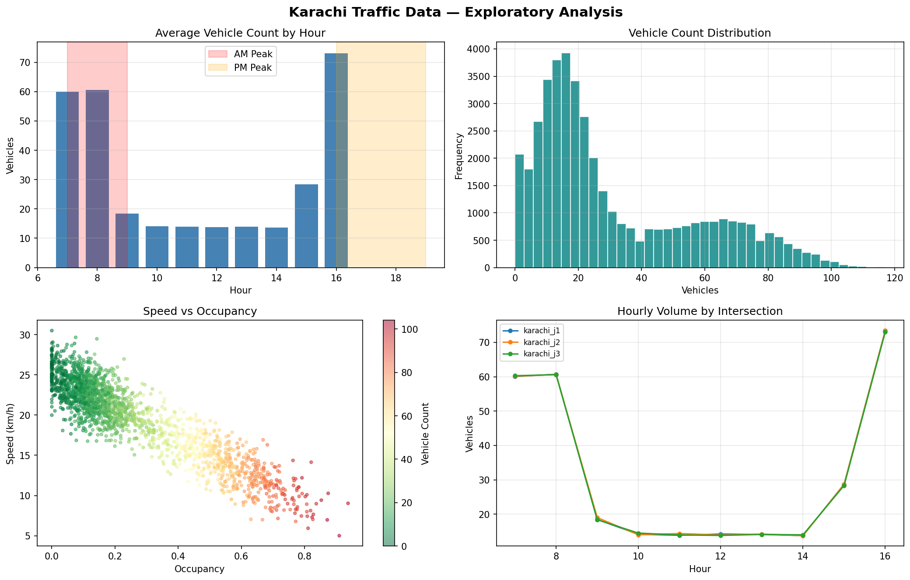

# 🚦 ITMS Karachi — Intelligent Traffic Management System

AI pipeline for adaptive traffic-signal control at a Karachi-style intersection:
**YOLOv8** vehicle detection → **LSTM** traffic forecasting → **Double-DQN** signal timing, with emergency and accident overrides.

*Iqra University · BS Computer Science · AI Project · by [@Tahir64506](https://github.com/Tahir64506)*

### ▶️ [Live interactive 3D demo](https://tahir64506.github.io/itms-karachi/)
A real-time 3D/2D traffic simulation (left-hand traffic, turning vehicles, pedestrians, night and rain). Drag to orbit, scroll to zoom. *(Works once GitHub Pages is enabled: Settings → Pages → Branch `main`, folder `/docs`.)*

---

## Results (measured in simulation)

Every policy was evaluated on the **same 30 random one-hour scenarios**, never used for training or validation.

| Metric | Typical plan<br>(Fixed 60 s) | Best fixed plan<br>(Fixed 30 s) | **ITMS (DQN)** | Change vs best fixed | Rule-based reference* |
|---|---|---|---|---|---|
| Avg wait per vehicle | 181.4 s | 125.5 s | **101.7 s** | **-19.0%** | 85.2 s |
| Throughput (vehicles/h) | 1183 | 1194 | **1209** | **+1.2%** | 1228 |

ITMS cuts waiting time by **44%** against a typical 60 s plan.
\* *A hand-written controller that sees the same queues. It still beats the learned DQN, so ITMS is shown to beat fixed-time signals, not to be optimal.*

**LSTM forecast (unseen test data):** R² **0.863** · MAE **7.7 vehicles** · RMSE **9.7 vehicles** — all three targets met. On this synthetic data (smooth curve + random noise) the theoretical ceiling is about R² 0.91, so the model is close to the limit.


<details>
<summary><b>More charts</b></summary>

**DQN training** — reward, validation score (best checkpoint kept) and exploration schedule


**LSTM** — loss curve and a 15-step forecast


**Synthetic Karachi traffic data**


</details>

## How it works

1. **Detect** — YOLOv8 counts cars, buses, trucks and motorbikes and flags emergency vehicles.
2. **Forecast** — a 3-layer LSTM reads the last 30 readings and predicts the next 15 steps (150 s) of vehicle count.
3. **Decide** — a Double-DQN observes the four queues, phase and elapsed time, and chooses a green of 20–120 s.
4. **Protect** — emergency vehicles force at least 90 s of green on their approach; accidents extend green by 20 s.

The DQN trains in a custom simulator where green time has a real cost (4 s lost time per phase change, vehicles keep arriving while others wait), using Huber loss, gradient clipping, reward scaling and best-checkpoint selection (400 episodes).

## Repository layout

| Path | Contents |
|---|---|
| `notebooks/ITMS_Karachi_Kaggle_v2.ipynb` | Full pipeline: data → LSTM → DQN → evaluation → dashboard. Resumable, with start-up smoke tests |
| `docs/index.html` | The interactive 3D/2D simulation page (served by GitHub Pages) |
| `models/` | Trained LSTM and DQN (`.keras`), `scaler.json`, metrics |
| `results/` | Charts, `evaluation.csv`, `pipeline_log.csv` |

The dataset is not stored: the notebook regenerates it (seeded, identical every run).

## Run it

**On Kaggle (recommended):** upload the notebook → *Save & Run All (Commit)*. GPU is optional; Internet is only needed for the optional YOLO demo. It finishes in a few minutes and resumes automatically if interrupted.

**Locally:** `pip install -r requirements.txt`, then open the notebook in Jupyter.

## Use the trained models

```python
import json, numpy as np, tensorflow as tf
sc   = json.load(open("models/scaler.json"))            # mean/scale for the 6 numeric features
lstm = tf.keras.models.load_model("models/lstm_final.keras")   # input (1, 30, 10) -> 15 forecasts (normalised)
dqn  = tf.keras.models.load_model("models/dqn_traffic_signal.keras")  # input (1, 7) -> 9 Q-values
ACTIONS = [20, 30, 40, 50, 60, 70, 80, 90, 120]        # green durations (s)
state = np.zeros((1, 7), "float32")                    # see make_state() in the notebook
green = ACTIONS[int(np.argmax(dqn.predict(state, verbose=0)))]
```

## Limitations

- Simulated environment and synthetic data — not live Karachi sensors.
- The learned DQN beats every fixed-time plan but not the rule-based reference.
- The YOLO demo uses a synthetic image; real vehicle counts need real road footage.
- The web demo's controller is a queue-responsive rule that mimics the learned policy; the DQN numbers above come from the Python simulator.
- One lane per direction, two-phase signals, left turns only; right turns and multi-lane roads are future work.
